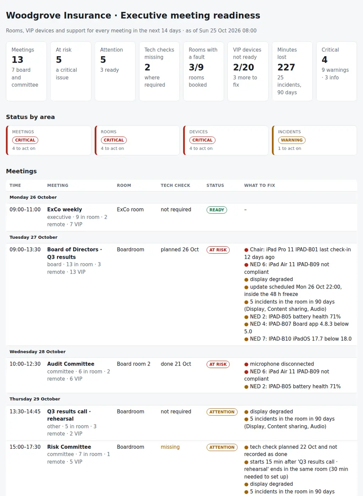

# Executive Meeting Readiness

The weekly readiness check of the meetings that cannot go wrong: board meetings, committees, executive committee, investor calls and town halls. For every meeting in the next two weeks it puts together:

- **The meeting:** the tech check, a room that fits, setup time between bookings and the engineer on site.
- **The room:** the Teams Room online and reporting, camera, microphones, speakers and displays working, no update scheduled the night before, and its incident history.
- **The VIP devices:** each attendee's iPad, laptop or phone compliant, recently checked in, on the minimum OS and board app version, with a healthy battery.

Five CSVs, one JSON with the rules and one Python command give each meeting a verdict (**ready**, **attention** or **at risk**) and produce the readiness pack for the team: **what could fail in which meeting, and who fixes it before it starts.**

Python 3.10+, standard library only. It runs with fictional demo data out of the box. A read-only PowerShell exporter for Microsoft Graph (Teams Rooms health, room calendars and Intune devices) is included.



## Why

When the board meeting starts, nobody remembers the dashboard was green. They remember the remote director who could not hear the room, the chair's iPad that had not synced the pack, or the update that rebooted the room at 08:55. Each of those was visible days before:

- the microphone array showed as disconnected in the Teams Rooms health;
- the iPad had not checked in to the MDM for twelve days;
- the update was scheduled for the night before;
- the rehearsal planned for last Thursday never happened, and the same boardroom display had failed three times in the quarter.

The signals live in the Teams admin center, Intune or Jamf, the room calendars, the service desk and the executive office's list of meetings. The check that matters joins them per meeting, because the same degraded display is a note for an internal workshop and a decision for the board. The rules are in `settings.json` and `boardready/checks.py`.

For the health of the whole Teams Rooms fleet, every room every morning, see [17-teams-rooms-fleet-health](https://github.com/inigogonzalezgarcia/17-teams-rooms-fleet-health); this tool starts from the meetings instead.

## What it checks

| Area | Code | Finding |
|---|---|---|
| Meetings | MTG-01 | Board, committee and investor meetings without a tech check in the last `tech_check_window_days`; critical within `tech_check_lead_days` |
| Meetings | MTG-02 | More people than seats, a hybrid meeting in a room with no Teams Room, or a room not in the register |
| Meetings | MTG-03 | Overlapping bookings in the same room (critical) or less than `setup_minutes` after the previous meeting |
| Meetings | MTG-04 | No support engineer assigned |
| Rooms | ROOM-01 | Room system offline or not reporting for `heartbeat_hours` |
| Rooms | ROOM-02 | Camera, microphone, speaker, display or console faulty; critical when audio or video is disconnected in a hybrid meeting |
| Rooms | ROOM-03 | Update scheduled inside the `freeze_hours` before the meeting |
| Rooms | ROOM-04 | Rooms behind the target version (for information) |
| Devices | DEV-01 | VIP device not compliant or not checked in for `checkin_days` |
| Devices | DEV-02 | OS or board app below the minimum version |
| Devices | DEV-03 | Battery health below `battery_min_pct` |
| Devices | DEV-04 | VIP attendee with no registered device |
| Devices | DEV-05 | Devices out of warranty or ending within `warranty_warn_days` (for information) |
| Incidents | INC-01 | Room with `repeat_incidents` or more incidents in `incident_window_days` |
| Incidents | INC-02 | Incidents and minutes lost by category (for information) |

## Outputs

| File | What |
|---|---|
| `report.html` | Tiles, status by area, the meetings day by day with their verdict and what to fix, "Fix first", rooms, VIP devices with something to do, incidents by room, all findings |
| `readiness-pack.md` | Summary, decisions with owners, and a checklist per meeting: tech check, room, each VIP attendee and device |
| `meeting-readiness.csv` | Every meeting with its tech check, number of VIP attendees, verdict and issues |
| `room-health.csv` | Every room: health, heartbeat, version, next update, peripheral faults, meetings booked, incidents and minutes lost |
| `vip-devices.csv` | Every VIP device: OS, compliance, last check-in, board app, battery, warranty, next meeting and status |
| `incidents-by-room.csv` | Incidents and minutes lost per room or device, with the categories and the last one |
| `actions.csv`, `findings.csv` | The findings with owner and next step, ready for a tracker |

## Try it

```bash
git clone https://github.com/inigogonzalezgarcia/33-executive-meeting-readiness.git
cd 33-executive-meeting-readiness
python -m boardready demo
```

Open `output/report.html` and `output/readiness-pack.md`.

### The demo data

The demo is a made-up insurer, Woodgrove Insurance, with eleven rooms in three offices (Crestron Flex, Logitech Rally and Poly Studio X systems), 13 meetings in the next two weeks, 20 VIP devices (iPads, MacBooks and iPhones in Jamf Pro and Intune) and 25 room incidents in the last 90 days, reviewed on Sunday 25 October 2026 at 08:00. All names are fictional.

The problems are placed on purpose:

- **Board of Directors, Tuesday:**
  - the chair's iPad has not checked in for twelve days, and one director's iPad is not compliant;
  - other directors' iPads have a worn battery, an old board app and an old iPadOS;
  - the boardroom's second display is degraded and a room update is scheduled for the night before;
  - the boardroom had five incidents in the quarter.
- **Audit Committee:** the tech check was done, but the room's microphone array has been disconnected since.
- **Risk Committee:** the tech check planned for last week was never recorded, and the meeting starts 15 minutes after a rehearsal in the same room.
- **Remuneration Committee:** the Lisbon board room has been offline for three days, with no tech check planned.
- **Other meetings:**
  - a strategy workshop for 12 is booked in a room for 8;
  - the Nomination Committee is hybrid but booked in the chair's office, which has no Teams Room;
  - the investor call has no support engineer;
  - a subsidiary director has no registered device.

## Use it with your own meetings

1. Export the room health, the room bookings and the VIP devices (read-only, Microsoft Graph):
   ```powershell
   .\scripts\Export-MeetingReadiness.ps1 -OutputFolder .\data -Days 14 -RoomMailboxes boardroom@contoso.com -VipUsers chair@contoso.com
   ```
   - The script only reads (TeamworkDevice.Read.All, Calendars.Read.Shared, DeviceManagementManagedDevices.Read.All) and stores no credentials.
   - Apple devices in Jamf Pro: export the same columns from an advanced search.
2. Complete `meetings.csv` (type, remote attendees, support engineer, tech checks) and write `attendees.csv` with the VIP attendees and their devices.
3. Add `incidents.csv` from the service desk and `data/settings.json` with your minimum versions, freeze window and owners ([docs/data-format.md](docs/data-format.md)).
4. Build the outputs:
   ```bash
   python -m boardready review data/ --title "Meeting readiness · week 44"
   ```

[docs/readiness-runbook.md](docs/readiness-runbook.md) has the 20-minute weekly check, how to read each signal and what to confirm the day before a board meeting.

The exports contain names, meetings and devices of executives. Keep them inside your organisation:

- real files at the top level (`meetings*.csv`, `rooms*.csv`, `attendees*.csv`, `devices*.csv`, `incidents*.csv`, `settings.json`, `data/`) and the `output/` folder are excluded from Git by `.gitignore`;
- only the fictional files in `sample_data/` are committed.

## Tests

```bash
pip install -r requirements-dev.txt
python -m pytest -q
```

GitHub Actions runs them on Python 3.10 and 3.12 on every push, then rebuilds the fictional sample data and the report screenshot from the simulator.

13 tests: meetings, rooms, attendees and devices exported with other column names, accents and semicolons; settings; the tech check rules; room fit, overlaps and setup time; support engineers; room health, peripherals and the update freeze; repeated incidents and versions; device readiness; VIP attendees per meeting; and the demo end to end (deterministic, all eight outputs).

## Next steps

- Read the board portal's attendance and pack downloads, to see which directors have not opened the pack.
- Device health from Jamf Pro's API directly, including battery health for iPads.
- A Teams or email summary to the executive office the day before each board meeting.
- Post-meeting feedback (minutes lost, what failed) written back into the incident log, closing the loop with INC-01.

## Background

Built from my work supporting board and executive committee meetings:

- Microsoft Teams Rooms on Crestron, with Logitech and Poly systems;
- iPads, MacBooks and iPhones managed with Jamf Pro and Intune;
- VIP support for executives and board members.

Written from scratch with fictional data; no employer data, systems or exports are used.

## Customisation and contact

Want this adapted to your organisation? For example:

- your meeting types, tech check rules and freeze window;
- your board portal and the minimum versions it needs;
- a readiness pack in the format your executive office uses;
- the check written into your service desk or sent the day before each board meeting.

Get in touch:

- Website (contact form): [inigogonzalezgarcia.github.io](https://inigogonzalezgarcia.github.io/about.html#contacto)
- LinkedIn: [linkedin.com/in/igonzalez93](https://www.linkedin.com/in/igonzalez93)

## License

MIT
